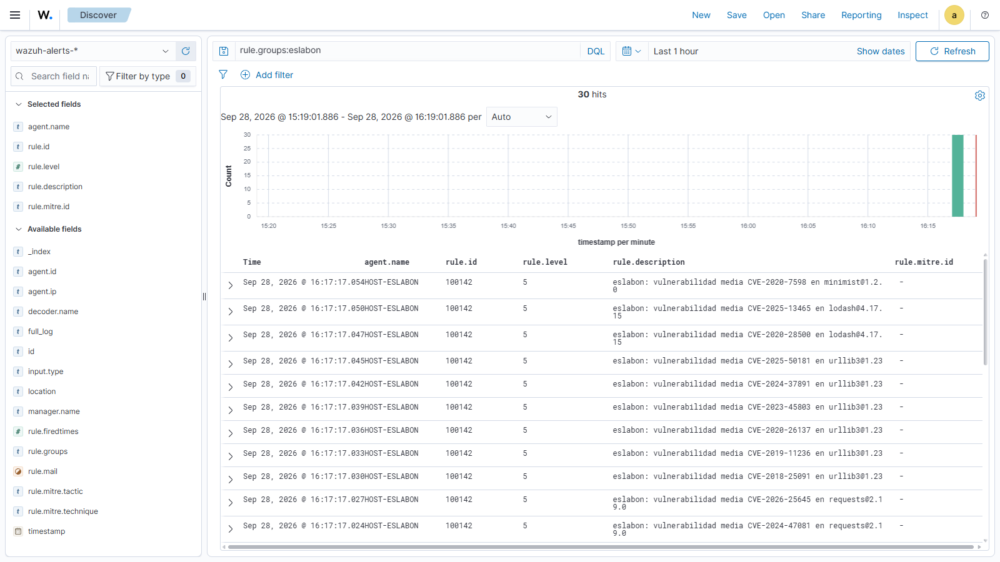

# Validación de las reglas de Wazuh en el laboratorio

**Fecha:** 2026-09-28 · **Manager:** `wazuh-siem`, Wazuh **4.14.7** (VM Ubuntu del lab casero) ·
**Acceso:** dashboard en `https://127.0.0.1:8443`, desde un Chromium limpio manejado con Playwright.
El usuario inició sesión él mismo en esa ventana; no se usó su perfil de Chrome ni se escribieron
contraseñas.

## Qué se cambió en el manager (con autorización del usuario)

1. **Fichero nuevo** `/var/ossec/etc/rules/eslabon_rules.xml`. No se tocó `local_rules.xml`, que
   solo tiene la regla de ejemplo 100001, así que no hay choque con el rango 100100–100199.
2. Validación de la configuración (`GET /manager/configuration/validation` → `OK`).
3. Reinicio del manager (`PUT /manager/restart`). Las reglas quedaron cargadas.

Para **deshacerlo**: borrar ese fichero (`DELETE /rules/files/eslabon_rules.xml`) y reiniciar.

## Error encontrado por la validación

El primer intento de carga falló con `1113 - XML syntax error`. Se diagnosticó sin adivinar:

1. **¿El contenido es XML válido?** Se ejecutó localmente el validador oficial de la API
   (`validate_wazuh_xml` y `load_wazuh_xml` de `framework/wazuh/core/utils.py`, v4.14.7). Resultado:
   el fichero es válido, así que el problema no era la sintaxis.
2. **¿Es el transporte?** Un fichero mínimo con una regla trivial se aceptó. Entonces el transporte
   funciona y hay algo del contenido que el servidor rechaza.
3. **Bisección:** se subió cada una de las 13 reglas por separado. Solo fallaba la **100101**, la
   única con `<decoded_as>eslabon</decoded_as>`. La misma regla con `decoded_as json` se aceptó.

**Causa:** la regla hacía referencia a un decoder propio (`eslabon`, para la vía por syslog) que no
estaba instalado. El manager lo informa como "XML syntax error" y rechaza el fichero **entero**.
**Corrección:** se eliminó la vía por syslog (regla 100101 y `eslabon_decoders.xml`). Las reglas
quedaron autocontenidas y dependen solo del decoder `json` incorporado de Wazuh.

**Lección:** los tests locales comprobaban la sintaxis y la lógica, pero no las **referencias** a
decoders instalados en el servidor. Solo un manager real puede validar eso.

## Resultados de logtest (11 de 11 reglas)

Eventos generados por `eslabon scan … -f siem`. "Real" significa que salen de un escaneo en vivo;
"construido" significa que se armaron con el mismo código de salida (`salidas/siem.py`) para cubrir
ramas que ningún paquete real produjo en la prueba.

| Evento | Origen | Decoder | Regla | Nivel | MITRE |
|---|---|---|---|---|---|
| malicioso / crítica | real: `npm:flatmap-stream@0.1.1` | json | 100110 | 14 | T1195.001 |
| sospechoso / alta | construido | json | 100120 | 10 | T1195.001 |
| sospechoso / media | real: `npm:event-stream@3.3.5` | json | 100121 | 7 | T1195.001 |
| sospechoso / baja | construido | json | 100122 | 3 | — |
| riesgo_origen / info | real: `pypi:mdurl@0.1.2` | json | 100130 | 5 | T1195.002 |
| vuln / crítica | real: `minimist@1.2.0` (proyecto demo) | json | 100140 | 12 | — |
| vuln / alta | real: `jinja2@2.10` | json | 100141 | 8 | — |
| vuln / media | real: `jinja2@2.10` | json | 100142 | 5 | — |
| vuln / baja | construido | json | 100143 | 3 | — |
| fuente_omitida | real (GuardDog sin configurar) | json | 100150 | 4 | — |
| resumen | real | json | 100160 | 2 | — |

Ejemplo de descripción expandida (regla 100110):
*"eslabon: paquete MALICIOSO npm/flatmap-stream@0.1.1 (MAL-2025-20690, fuentes: ["osv", "depsdev"])"*.
Wazuh añade la táctica *Initial Access* y la técnica *Compromise Software Dependencies and
Development Tools* a partir del ID T1195.001.

## Ingesta de punta a punta (hecha)

Arquitectura final del lab:

```
este Windows (host)                          VirtualBox · Red NAT "SOCLAB" (10.10.10.0/24)
┌────────────────────────────┐               ┌───────────────────────────────────────────┐
│ eslabon scan … -f siem     │               │ wazuh-siem (10.10.10.10) · Wazuh 4.14.7   │
│   -o resultados\eventos.jsonl --anexar     │   reglas eslabon_rules.xml (100100-100160)│
│             │              │  127.0.0.1:1514/1515 ─► analysisd → wazuh-alerts-* → dashboard │
│ agente HOST-ESLABON (002)  ├──────────────►│   grupo "eslabon": agent.conf con el      │
│   grupo "eslabon"          │               │   <localfile> log_format json             │
└────────────────────────────┘               └───────────────────────────────────────────┘
```

Cambios hechos, todos con autorización del usuario:

| Dónde | Cambio | Cómo deshacerlo |
|---|---|---|
| VirtualBox, Red NAT `SOCLAB` | `wazuh-agente` 127.0.0.1:1514 → 10.10.10.10:1514 y `wazuh-registro` 127.0.0.1:1515 → 10.10.10.10:1515 | `VBoxManage natnetwork modify --netname SOCLAB --port-forward-4 delete wazuh-agente` (ídem `wazuh-registro`) |
| Manager | Grupo `eslabon`, cuyo `agent.conf` lee `…\eslabon\resultados\eventos.jsonl` con `log_format json` | `DELETE /groups?groups_list=eslabon` |
| Este Windows | Agente oficial 4.14.7 (`HOST-ESLABON`, id 002, grupo `eslabon`). Lo instaló el usuario como administrador | Desinstalar "Wazuh Agent" desde Configuración |

Verificaciones del instalador del agente:
- **Integridad:** SHA512 igual al publicado en `packages.wazuh.com` (`d0cac595…`).
- **Autenticidad:** firma Authenticode **válida**, emitida a *Wazuh, Inc*.

**Resultado:** 3 escaneos (`flatmap-stream@0.1.1`, `event-stream@3.3.5` y el proyecto demo)
generaron 33 eventos, y en `wazuh-alerts-*` aparecieron **30 alertas** de `HOST-ESLABON`:
- 100110 (malicioso, nivel 14, T1195.001);
- 100121 (sospechoso, nivel 7, T1195.001);
- 100140, 100141 y 100142 (vulnerabilidades crítica, alta y media).

Los 3 eventos de "resumen" disparan la 100160, de nivel 2, y **no** se guardan como alerta. Es lo
esperado: el umbral por defecto de Wazuh para guardar alertas es 3.



## Pendiente

- **Escaneo programado.** Una tarea del Programador de tareas que ejecute
  `eslabon scan … -f siem -o …\resultados\eventos.jsonl --anexar --fallar-en nunca`, con
  `ESLABON_GUARDDOG` definida como variable de usuario.
- **Rotación de `eventos.jsonl`.** Con `--anexar` el fichero crece sin límite.
- Evaluar `<options>no_full_log</options>` para no duplicar el JSON completo en cada alerta.
